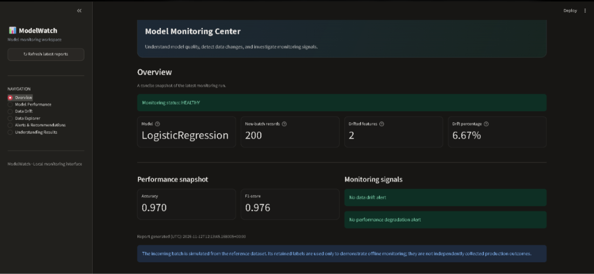
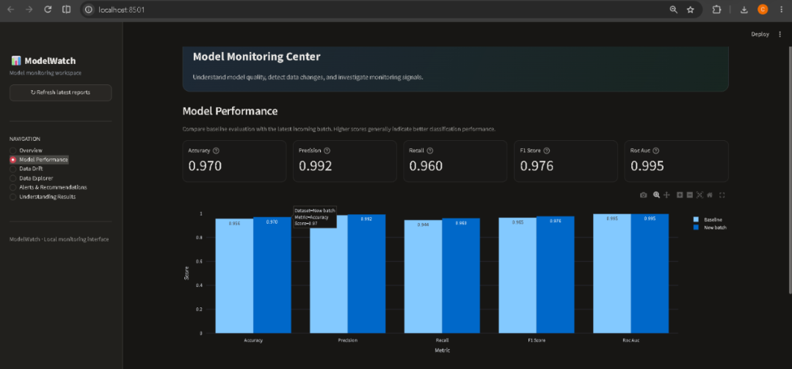
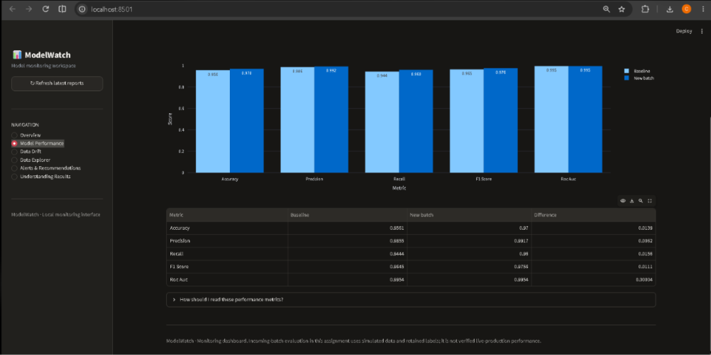
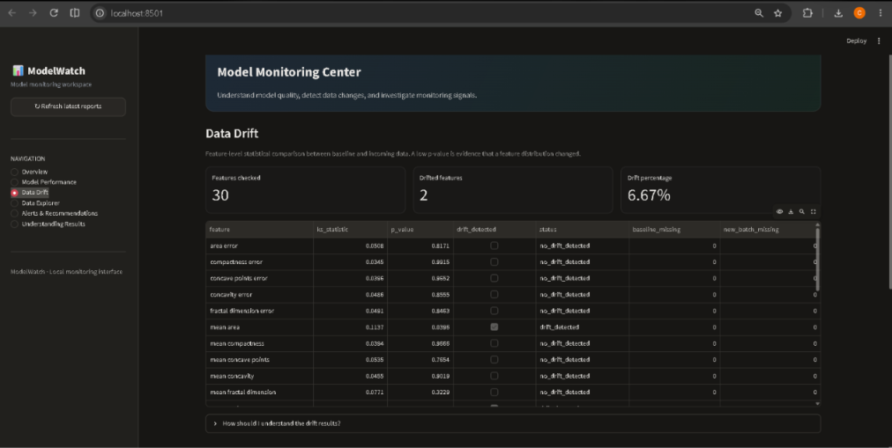
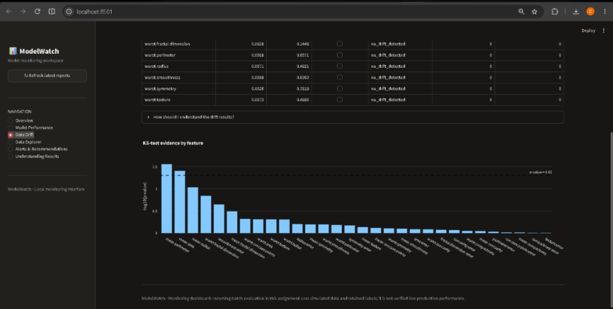
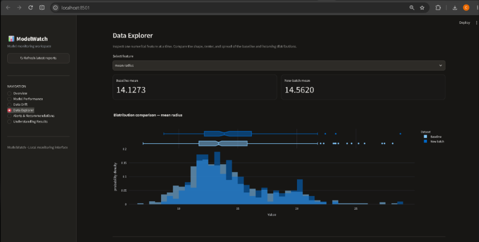
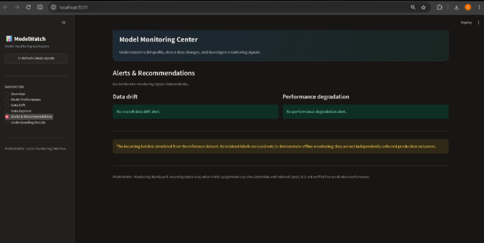
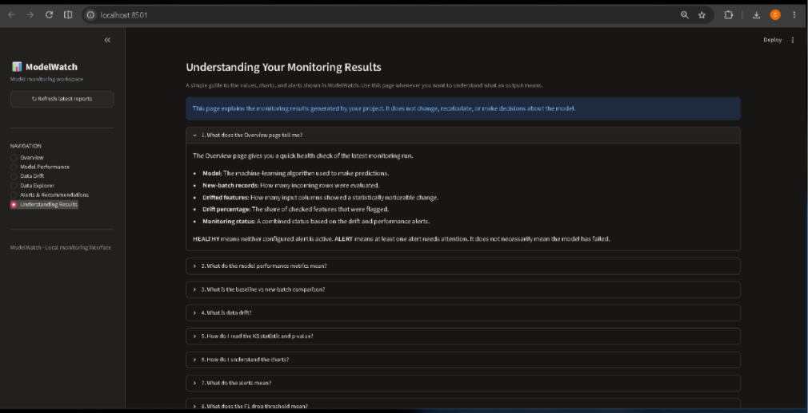

# MLOps Model Monitoring & Data Drift Dashboard

**ModelWatch** is a local end-to-end MLOps demonstration that trains and evaluates a binary classification model, tracks experiments with MLflow, simulates an incoming data batch, detects feature distribution drift, and presents monitoring results in an interactive Streamlit dashboard.

> **Important data note:** This project uses the built-in Breast Cancer Wisconsin dataset from scikit-learn. The incoming batch is simulated from the reference dataset and retains its original labels for demonstration. It is not live production data, and its evaluation scores must not be presented as verified production performance.

---

## Dashboard Preview

The following screenshots were captured from the running local Streamlit application. They show the actual interface and sample results from the run at the time of capture. Metric values and drift findings may change when the pipeline is rerun.

### 1. Monitoring overview

The overview provides a quick health summary, including the selected model, incoming record count, drifted feature count, drift percentage, performance snapshot, and current alert signals.



### 2. Model performance

The dashboard displays accuracy, precision, recall, F1-score, and ROC-AUC for the incoming batch.



The comparison view places baseline and new-batch scores side by side and shows their differences.



### 3. Data drift analysis

The feature-level table reports the KS statistic, p-value, drift decision, and missing-value counts for the numerical input features.



The KS evidence chart helps identify features with the strongest statistical evidence of distribution change. The dashed reference line represents the configured p-value threshold of 0.05.



### 4. Data explorer

Users can select a numerical feature and compare baseline and incoming distributions using summary values, box plots, and overlaid histograms.



### 5. Alerts and recommendations

Drift and performance degradation are shown as separate monitoring signals. A drift alert does not automatically mean model performance has degraded.



### 6. Understanding results

The dashboard includes a plain-language guide to metrics, drift, KS statistics, p-values, charts, alerts, and the limitations of the simulated batch.



---

## 1. Features

- Dataset exploration using the scikit-learn Breast Cancer Wisconsin dataset.
- Reproducible train/test split using stratification and random seed 42.
- Preprocessing with a saved imputer/scaler pipeline.
- Comparison of classification models using cross-validation.
- MLflow experiment tracking.
- Baseline model evaluation and confusion matrix.
- Simulated incoming batch with intentionally shifted numerical features.
- Data drift detection using the two-sample Kolmogorov-Smirnov (KS) test.
- Monitoring report combining data drift and model performance.
- Streamlit dashboard with separate Overview, Model Performance, Data Drift, Data Explorer, Alerts & Recommendations, and Understanding Results pages.
- Automated tests for data splitting, saved model predictions, drift calculations, and monitoring report structure.

## 2. Technology stack

- Python
- pandas and NumPy
- scikit-learn and SciPy
- joblib
- MLflow
- Streamlit and Plotly
- PyYAML
- pytest

The project was tested locally on Windows using **Python 3.14.4** and **pytest 9.2.0**.

## 3. Project structure

```text
MLOps-Model-Monitoring/
├── config/
│   ├── __init__.py
│   ├── config.yaml
│   └── paths_config.py
├── src/
│   ├── __init__.py
│   ├── data_ingestion.py
│   ├── data_preprocessing.py
│   ├── data_generation.py
│   ├── model_training.py
│   ├── model_evaluation.py
│   ├── data_drift.py
│   └── model_monitoring.py
├── pipeline/
│   ├── __init__.py
│   └── monitoring_pipeline.py
├── utils/
│   ├── __init__.py
│   └── mlflow_utils.py
├── artifacts/
│   ├── data/
│   ├── models/
│   └── reports/
├── notebook/
│   └── 01_data_exploration.ipynb
├── tests/
│   ├── test_preprocessing.py
│   ├── test_model.py
│   ├── test_drift.py
│   └── test_monitoring_report.py
├── screenshots/
│   ├── 01_overview.png
│   ├── 02_model_performance.png
│   ├── 03_performance_comparison.png
│   ├── 04_data_drift_features.png
│   ├── 05_ks_test_evidence.png
│   ├── 06_data_explorer.png
│   ├── 07_alerts_recommendations.png
│   └── 08_understanding_results.png
├── application.py
├── requirements.txt
├── setup.py
├── pytest.ini
├── README.md
└── .gitignore
```

Only include files that actually exist in the repository. For example, add a `training_pipeline.py`, `common_functions.py`, or `visualization.py` entry only if that module has been implemented.

## 4. Installation (Windows)

Open CMD or PowerShell in the project root.

```powershell
py -3.14 -m venv .venv
.\.venv\Scripts\Activate.ps1
python -m pip install --upgrade pip
pip install -r requirements.txt
pip install -e .
```

For CMD, activate the environment using:

```cmd
.venv\Scripts\activate
```

If PowerShell blocks activation:

```powershell
Set-ExecutionPolicy -Scope Process -ExecutionPolicy Bypass
.\.venv\Scripts\Activate.ps1
```

Jupyter is needed only for the optional exploration notebook:

```bash
pip install notebook ipykernel
jupyter notebook
```

If a dependency does not yet support your Python version, use a compatible Python release and update the environment instructions to match the version you actually tested.

## 5. Run the project in order

Run commands from the project root, where `config`, `src`, and `pipeline` are located.

```bash
# Step 2: Explore the dataset (optional notebook)
jupyter notebook

# Step 3: Data ingestion
python -m src.data_ingestion

# Step 4: Preprocessing
python -m src.data_preprocessing

# Steps 5 and 6: Model training and MLflow tracking
python -m src.model_training

# Step 7: Baseline model evaluation
python -m src.model_evaluation

# Step 8: Generate the simulated incoming batch
python -m src.data_generation

# Step 9: Detect data drift
python -m src.data_drift

# Step 10: Run combined monitoring
python -m pipeline.monitoring_pipeline

# Step 11: Launch the dashboard
streamlit run application.py
```

The dashboard expects the monitoring report and baseline/new-batch CSV files to exist. Run the monitoring pipeline again after generating a new batch, then refresh the dashboard.

To view the MLflow tracking interface, use a second terminal:

```bash
mlflow ui --backend-store-uri sqlite:///mlflow.db
```

Then open `http://127.0.0.1:5000`.

## 6. Automated testing

Run all tests from the project root:

```bash
pytest -v
```

### Recorded test run

The following result was provided from the local Windows environment:

| Test result | Value |
|---|---:|
| Tests collected and executed | 7 |
| Passed | 7 |
| Failed | 0 |
| Execution time | 1.68 seconds |
| Python | 3.14.4 |
| pytest | 9.2.0 |

**Result: 7 passed, 0 failed.**

Thirteen non-blocking deprecation warnings were emitted by the installed LangSmith dependency. They did not cause test failures.

The tests cover:
- Feature/target separation.
- Reproducible and stratified train/test splitting.
- Predictions from the saved model and preprocessor.
- Overall drift percentage and drift threshold behavior.
- Drift report generation.
- Monitoring report structure and alert fields.

Run an individual test file:

```bash
pytest tests/test_preprocessing.py -v
pytest tests/test_model.py -v
pytest tests/test_drift.py -v
pytest tests/test_monitoring_report.py -v
```

Some integration tests require generated artifacts. Run the project workflow first if a test is skipped because its input files are not present.

A passing test confirms only the behavior covered by that test; it does not establish that every part of the application is production-ready.

## 7. Reproducibility

- The dataset is loaded from scikit-learn; no manual dataset download is required.
- Use `random_state=42` for the train/test split.
- Keep configured random seeds unchanged when reproducing the same run.
- Use the same Python and package versions when comparing results.
- Run the modules in the documented order.
- Record the environment used for the final submission:

```bash
python --version
pip freeze > environment-lock.txt
```

The `environment-lock.txt` file is optional but helps another developer recreate the tested environment. Pin package versions in `requirements.txt` after validating them in the final environment.

## 8. Sample outputs and artifacts

Recommended generated files:

```text
artifacts/
├── data/
│   ├── baseline_data.csv
│   ├── X_train.csv
│   ├── X_test.csv
│   ├── y_train.csv
│   ├── y_test.csv
│   └── new_batch.csv
├── models/
│   ├── model.pkl
│   └── preprocessor.pkl
└── reports/
    ├── model_comparison.csv
    ├── model_metrics.json
    ├── baseline_evaluation_report.json
    ├── drift_report.json
    └── monitoring_report.json
```

Include the sample datasets and reports needed for the reviewer to inspect the project. Include model binaries only if their size is reasonable and the assignment submission instructions permit them. Do not include the MLflow database unless required.

## 9. Git and GitHub submission

Review staged and unstaged files:

```bash
git status
```

Stage the project files:

```bash
git add .
git status
```

Before committing, confirm that `.venv`, `.env`, credentials, cache directories, temporary files, and private data are not staged.

Commit and push:

```bash
git commit -m "Complete MLOps model monitoring dashboard with drift detection, MLflow and tests"
git push origin main
```

If your default branch is not `main`, use the correct branch name.

Verify the repository:
1. Open the GitHub repository URL in a private/incognito browser window.
2. Confirm that README, source files, tests, requirements, screenshots, and approved sample outputs are visible.
3. Confirm that no secrets or private information were uploaded.
4. If possible, clone the repository into a fresh folder and follow the README installation and execution steps.

## 10. Final submission checklist

- [ ] All required source modules are present.
- [ ] Data ingestion and preprocessing run successfully.
- [ ] Model training and MLflow tracking run successfully.
- [ ] Baseline evaluation report is generated.
- [ ] Simulated incoming batch is generated.
- [ ] Data drift report is generated.
- [ ] Monitoring report is generated.
- [ ] Streamlit dashboard opens and all pages load.
- [ ] Understanding Results content is clear and accurate.
- [x] Seven automated tests passed in the recorded test run.
- [ ] Random seeds and environment versions are recorded.
- [x] Dashboard screenshots are included in this README and `screenshots/`.
- [ ] README setup and run commands have been checked in a fresh environment.
- [ ] GitHub repository is public or shared with the evaluator.
- [ ] No secrets, credentials, or unintended files are committed.

## 11. Interpretation and limitations

Data drift and model performance degradation are different signals. Drift means input distributions changed; it does not prove that predictions became worse.

Performance evaluation requires trustworthy labels. In this assignment, labels are retained from a simulated sample, so the evaluation is for demonstration only and must not be represented as verified live-production performance.
